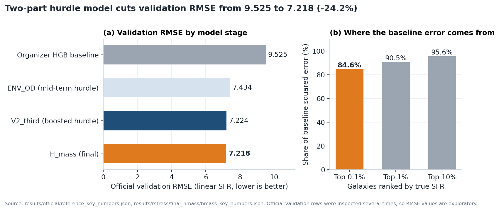
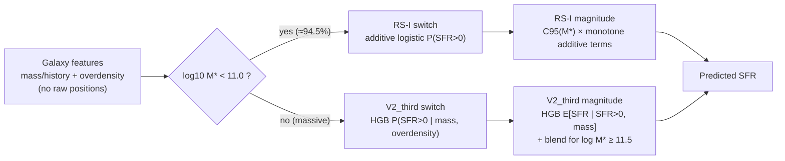
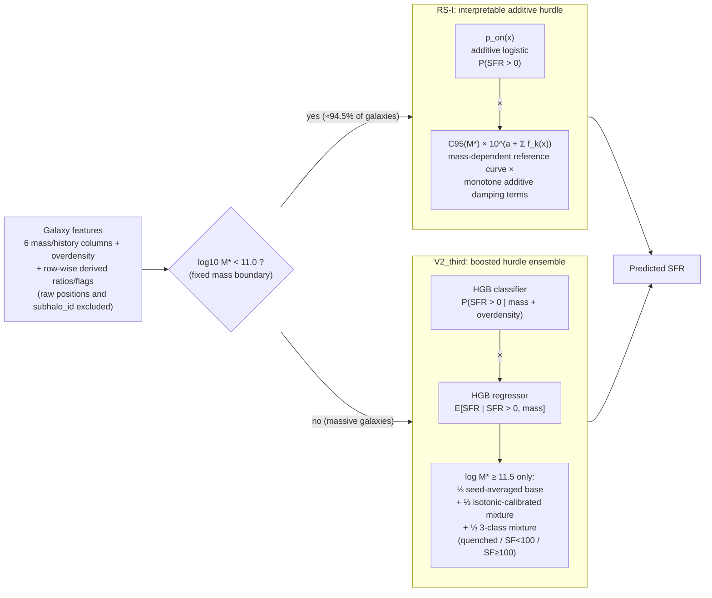
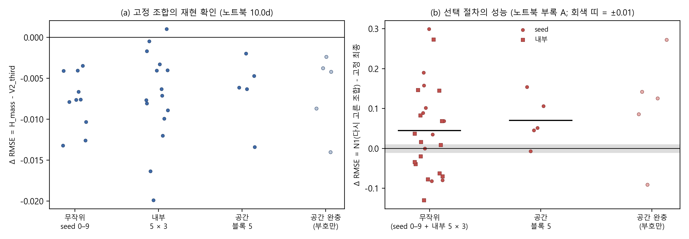
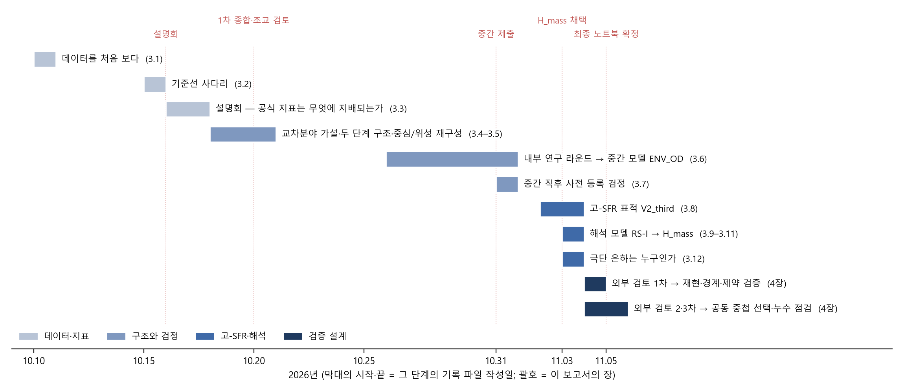

# Galaxy Star-Formation-Rate Prediction with a Two-Part (Hurdle) Model

A frequency × severity (hurdle) model for a zero-inflated, heavy-tailed target that cuts official validation RMSE from 9.525 to **7.218 (−24.2%)** against the organizer's baseline.


<p align="center"></p>

| | |
|---|---|
| **Context** | 1st Science Data Innovation Competition (SNU IDIS DataHub), Oct–Nov 2026. Track: *[Astronomy] star-formation-rate prediction from galaxy properties, position and velocity* |
| **Role** | Sole author (solo entry) |
| **Stack** | Python 3.10, pandas, NumPy, SciPy, scikit-learn (HGB, isotonic calibration, `GroupKFold`), matplotlib |
| **Data** | Public, CC BY 4.0 (SNU IDIS DataHub dataset 42); not redistributed here, see [data/README.md](data/README.md) |

## Key results

- Official validation RMSE **7.218** vs **9.525** for the organizer's HGB baseline (**−24.2%**). This is exploratory, not a clean holdout score: the official validation rows were inspected several times during development.
- The target is extreme: **8.66%** of galaxies have SFR exactly 0, the maximum (2,145) is over 1,000× the positive median, and in the baseline the **top 0.1%** of galaxies produce **84.6%** of the squared error (one galaxy alone 20.1%).
- The final model `H_mass` beats the boosted-only `V2_third` on **10/10** random seeds, **14/15** internal folds and **5/5** spatial folds, but the gain is tiny (about −0.008 RMSE). Its real value: **94.5%** of predictions come from a readable additive formula.
- Seed 0–9 mean RMSE **6.483**; spatial 5-fold pooled RMSE **7.585**. Leakage was audited and guarded against, not fully controlled: there is no independent holdout, and a nested re-selection showed the post-hoc choices were optimistic (**+0.045** random / **+0.070** spatial).

## Why it matters for insurance

| Galaxy SFR | Insurance analogue |
|---|---|
| SFR = 0 for 8.66% of galaxies | Policies with no claim in the period |
| Positive SFR spans 0.0073 to 2,145; max ≈ 1,000× median | Claim severity with a heavy (Pareto-like) tail |
| Quenching is driven by **environment** (overdensity), not mass | Claim *frequency* and *severity* often have different drivers |
| Linear-scale RMSE is dominated by a few extreme galaxies | Aggregate loss is dominated by a few large claims |

The model is the actuarial **frequency × severity** decomposition, the same two-part structure as the RAND Health Insurance Experiment model for medical expenditure (Duan et al., 1983; Cragg, 1971). Two lessons carry over to pricing: don't impute the zeros, and target the mean on the original scale (Duan smearing when fitting in log space).

## Approach



```
E[SFR | x] = P(SFR > 0 | x) × E[SFR | SFR > 0, x]
              ── "frequency" ──   ──── "severity" ────
```

- **Split the question.** "Is SFR > 0?" is almost entirely environmental (overdensity alone: switch AP 0.884 in spatial CV vs 0.600 for all 12 mass features); "how large?" is mostly mass.
- **Hybrid final model `H_mass`.** Interpretable additive hurdle `RS-I` below log M\* = 11; gradient-boosted hurdle ensemble `V2_third` for the massive galaxies that dominate the error.
- **Adopt by win count.** Each step was adopted only if it beat the incumbent on a pre-set share of paired comparisons, never because one score went down.

## Validation

| Model | Official val. RMSE | Official val. MAE | Seed 0–9 mean RMSE | Spatial 5-fold pooled RMSE |
|---|---:|---:|---:|---:|
| Median baseline | 12.345 | — | — | — |
| Organizer HGB baseline | 9.525 | 1.286 | — | — |
| ENV_OD (mid-term hurdle) | 7.434 | 1.090 | 6.945 | 7.805 |
| RS-I alone (interpretable) | 8.927 | 1.108 | — | — |
| V2_third | 7.224 | 1.042 | 6.490 | 7.591 |
| **H_mass (final)** | **7.218** | **1.002** | **6.483** | **7.585** |

| Check | What it guards against |
|---|---|
| Spatial-block CV (125 blocks of 40 units, 5-fold `GroupKFold`) + 5-unit buffer variant | Spatial / group leakage between neighbouring galaxies |
| 10 random-seed splits + 5-fold × 3-repeat internal CV | Single-split luck |
| 21 pre-registered analyses (documents) + 2 validation-plan documents | Choosing rules after seeing results |
| Leakage audit of every training statistic | Full-catalogue statistics leaking into training |
| Nested re-selection of 3 post-hoc settings (400 combinations) | Optimism of post-hoc choices: it showed **+0.045** / **+0.070** |

Model *selection* after the mid-term submission used only internal CV, 10 random-seed splits and spatial-block CV. Details in the *Technical details* section below.

## Reproduce

Data is not included: save the CSV as `data/raw/galaxy_sfr.csv` first ([data/README.md](data/README.md)).

```bash
pip install -r requirements.txt
python src/official_01_reference.py && python src/hl_00_common.py && python src/hl_10_final.py && python src/rs_09_final_model.py && python src/rs_30_final_hmass.py
python reports/make_figures.py && python src/rpt_06_process_figures.py   # figures from results/ JSON only, no data needed
```

The second line is the core path (baseline 9.525 → H_mass 7.218). The figure scripts run without the data. A cold rerun of every research script is not supported: some (`rs_20`, `rs_27`) read caches from exploratory scripts not in this repo. Full instructions are in *Technical details* below.

## Repository structure

```text
galaxy-sfr-hurdle-model/
├── README.md
├── requirements.txt              # pinned versions (Python 3.10)
├── data/README.md                # where to get the CSV (data itself not included)
├── src/
│   ├── hl_00_common.py           # shared harness: official split, inner CV, ENV_OD base model
│   ├── rs_00_common.py           # shared harness: seed / spatial / buffer splits, metrics, RS-I pieces
│   ├── official_*.py             # organizer baseline (9.525) and spatial CV of two-stage arms
│   ├── h1_*, i37_*, i38_*.py     # pre-registered analyses (re-tuning, BH residual, routing)
│   ├── hl_*.py                   # high-mass candidates, blends, V2_third final fit, seed noise
│   ├── rs_09 / rs_15             # RS-I interpretable model fit and seed-split check
│   ├── rs_20 – rs_28             # attempts not adopted: booster, stacking, routers
│   ├── rs_29 – rs_34             # H_mass final, repeated validation, nested boundary, ablations
│   └── rpt_06_process_figures.py # process-report figures -> reports/figures/
├── results/                      # small JSON outputs cited in this README (no data, no predictions)
└── reports/
    ├── make_figures.py           # hero figure from results JSON
    └── figures/                  # hero.png, prc_01_timeline.png, prc_02_validation.png
```

## Limitations

- **7.218 is exploratory.** The official validation rows were inspected several times during development.
- **No independent holdout or snapshot.** All repeated splits come from the same catalogue.
- **Frozen fold not kept.** A promised "frozen" spatial fold was reused during development, so it counts as an ordinary fold.
- **Post-hoc choices were optimistic.** Mass boundary, high-mass threshold and blend weights were chosen on internal out-of-fold predictions; a joint nested re-selection over 400 combinations did *worse* than the fixed final combination (mean ΔRMSE +0.045 random, +0.070 spatial).
- **Seed noise exceeds the margin.** Changing only internal `random_state` moves official H_mass RMSE between 7.218 and 7.288, larger than the H_mass − V2_third gap (though H_mass was lower in all 5 configurations).
- **The extreme tail is unsolved.** Errors for central galaxies of the heaviest haloes with SFR ≥ 400 were not stably reduced; RMSE in the SFR = 0 segment got worse than the mid-term model (1.72 → 1.85).

<details>
<summary><b>Technical details</b></summary>

### Problem framing

The task was to predict the star-formation rate (SFR) of 208,437 simulated galaxies. The target is **zero-inflated** (8.66% exactly 0, recorded zero, probably below simulation resolution) and **heavy-tailed** among the rest (maximum 2,145 vs positive median 1.80). The official metric is RMSE on linear SFR, so a handful of extreme galaxies dominate the score. In the organizer's baseline, 84.6% of the squared error comes from the top 0.1% of galaxies, and one galaxy alone accounts for 20.1%.

A single regression on a mixed target like this drags predictions for the zero mass upward and forces one set of features to explain both *whether* and *how much*. The fix is the actuarial **frequency × severity** split, or the econometric **hurdle / two-part model** (Cragg, 1971; Duan et al., 1983 — the RAND Health Insurance Experiment two-part model for medical expenditure).

In the pre-registered analysis of the division of labour:

- **Whether SFR > 0** is almost entirely environmental. Overdensity alone reached switch AP 0.884 (spatial CV), against 0.600 for all 12 mass features.
- **How large** is mostly about mass. Adding environment to the magnitude model made the tail inconsistent.

Practical lessons:

- **Don't impute the zeros.** Changing only the fill value for the zeros flipped the ranking of single-regression and two-stage models. An arbitrary fill value distorts evaluation, so zeros were never replaced by small numbers for a log regression.
- **Target the mean on the original scale.** The magnitude model targets the *linear* conditional mean, with Duan smearing when fitting in log space. Back-transforming a log-scale fit without that correction biases the mean low.

### Full model diagram



How the model evolved, with each step adopted only if it passed the pre-set rule:

| Stage | Model | Official RMSE | Why the next step |
|---|---|---:|---|
| Baseline | Organizer HGB on all raw columns | 9.525 | Mixed target; raw coordinates leak spatially |
| First two-stage | Hurdle HGB (switch × magnitude) | 7.414 | Single HGB on the same inputs: 8.073 |
| Mid-term | `ENV_OD`: switch = mass + overdensity, magnitude = mass | 7.434 | Same score with interpretable inputs; error concentrated in the high-SFR tail |
| High-mass target | `V2_third` | 7.224 | Better score but no interpretability |
| Interpretable | `RS-I` alone | 8.927 | Works below log M\* = 11, breaks above |
| **Final** | **`H_mass` = RS-I below 11.0, V2_third above** | **7.218** | — |

### Validation design

Galaxies cluster in filaments and groups, and neighbours share their quenching state. A random split therefore leaks group information — the same structure as splitting one policyholder's or one patient's records across train and test.

- **Spatial-block CV.** The simulation box (assumed periodic, 200 units) is cut into 125 blocks of 40 units, and folds are made with 5-fold `GroupKFold` on the blocks. A **buffer** variant also drops training galaxies within 5 units of any validation galaxy. Raw coordinates were removed from the inputs after a test showed that a classifier with coordinates lost most of its random-split PR-AUC advantage under spatial CV. The gap was 0.025 with coordinates and 0.001 without.
- **10 random-seed splits.** Repeated stratified 80/20 splits (seeds 0–9), plus 5-fold × 3-repeat internal CV inside the official training set.
- **Adoption by win count, not by a single score.** A candidate had to beat the incumbent on a pre-set share of paired comparisons. For example, V2_third beat ENV_OD on 9/10 seeds and 5/5 spatial folds. I never adopted a candidate because one score went down.
- **Pre-registration.** 21 pre-registration documents, plus 2 validation-plan documents, fixed the candidates, comparison grids and decision rules *before* results were seen. Several pre-registered analyses were negative, and they were reported as such.
- **Leakage audit.** Every training statistic was checked for where it is estimated: quantile knots, scaling, the reference curve, calibration, smearing and quenched means. One fill value was found that used the full catalogue minimum, and it was changed to a training-split statistic.
- **AI-assisted workflow.** Claude and other AI tools were used for code, literature checks and drafting. Ten research rounds ran as independent AI sessions that re-computed each other's results. All reported numbers are machine-copied from script outputs and auto-checked. The author made all research decisions.

**What this validation does *not* establish.** These limits are stated in the competition report:

- No independent holdout or snapshot was available. All repeated splits come from the same catalogue.
- A promised "frozen" spatial fold was in fact reused during model development, so it counts as an ordinary fold.
- Three settings (mass boundary, high-mass region threshold, blend weights) were post-hoc choices on internal out-of-fold predictions. A joint **nested re-selection** over 400 combinations performed *worse* than the fixed final combination: mean ΔRMSE +0.045 on random splits and +0.070 on spatial splits. By the pre-set reading rule, that means **the post-hoc selection was optimistic**.



Research timeline (Korean labels):



### Results notes

Linear-SFR RMSE. The official split is `train_test_split(test_size=0.2, random_state=42, stratify=SFR>0)` from the organizer's fixed template cell.

- **H_mass vs V2_third.** H_mass was lower on 10/10 random seeds, 14/15 internal folds and 5/5 spatial folds. The gain is tiny, however: about −0.008 RMSE. Its real value is that 94.5% of predictions come from a readable additive formula.
- **Seed noise.** Changing only the models' internal `random_state` moves the official H_mass score between 7.218 and 7.288. That range is larger than the H_mass − V2_third gap, although H_mass was lower in all 5 configurations.
- **Massive galaxies.** Below log M\* = 11, RMSE is 0.998 for H_mass and 1.045 for V2_third. Above it, V2_third alone produces 98% of the squared error.

Source files: `results/official/reference_key_numbers.json`, `results/rstress/final_hmass/hmass_key_numbers.json`, `results/rstress/rs_33_hmass_seed_noise.json` and `results/report/rpt_process_report_numbers.json`. The `script` fields inside these JSONs show the original layout, where `data/scripts/` is now `src/`.

### What didn't work

- **Raw positions as features.** They memorised "quenched neighbourhoods" and lost their benefit under spatial CV.
- **A neighbour-density feature built from positions.** It could not replace the organizer's overdensity and was worse than mass-only in spatial CV.
- **The "merger-burst" hypothesis for the tail.** Merger signatures turned out to be a generic property of massive haloes.
- **Six pre-registered follow-up analyses after the mid-term.** These covered magnitude re-tuning, BH-residual gating, a BH-residual single model and others. None changed the model.
- **Adding information to the high-mass model.** New features and bigger classifiers were worse. Only variance reduction helped: regularisation and seed or bootstrap averaging.
- **Learned routers** (high-SFR probability or direct "which model is right" classifier). Both were worse or less stable than a fixed mass boundary.
- **Interpretable high-mass models.** These were a 3-mode mixture with a monotone ≥100 booster, and cross-stacking. They were kept for explanation only.
- **The extreme tail.** Errors for central galaxies of the heaviest haloes with SFR ≥ 400 were not stably reduced by anything tried. RMSE in the SFR = 0 segment also got worse than the mid-term model (1.72 → 1.85).

### Script index

| Script | Purpose |
|---|---|
| `hl_00_common.py` | shared harness: official split, inner CV, ENV_OD base model + caches |
| `rs_00_common.py` | shared harness: splits (seed / spatial-block / buffer), metrics, RS-I pieces |
| `official_01_reference.py` | reproduces organizer baseline (9.525) + metric diagnostics |
| `official_03_part1_spatial.py` | spatial-block / buffer CV of the two-stage arms |
| `h1_inner_cv_select.py` | pre-registered analysis: magnitude-model re-tuning |
| `i37_bh_resid_single.py` | pre-registered analysis: BH-residual single model |
| `i38_routing_separability.py` | pre-registered analysis: "switch = environment, size = mass" |
| `hl_02_candidates.py` | high-mass candidate models (HS_mix, K_mix3, P_iso, ...) |
| `hl_03_blends.py` | region blends of saved predictions |
| `hl_08_v1_variance.py` | base-model variance reduction (seed / bootstrap averaging) |
| `hl_04b_confirm_bases.py` | seed 0–9 + spatial confirmation of V2_third |
| `hl_10_final.py` | V2_third final fit on the official training set |
| `hl_11_seed_noise.py` | random_state noise of V2_third |
| `rs_09_final_model.py` | RS-I interpretable model final fit (+ predict_rs) |
| `rs_15_seed_splits.py` | RS-I fitting helper + seed-split check |
| `rs_20_highmass_booster.py`, `rs_20b_*` | interpretable high-mass attempt (not adopted) |
| `rs_25_cross_stacking.py`, `rs_25b_*` | cross-stacking attempt; also defines V2_third builder `bb` |
| `rs_27_b3_fix.py`, `rs_27b_*` | booster blow-up fix |
| `rs_28_hybrid_router.py`, `rs_28b_*` | learned routers vs fixed mass boundary |
| `rs_29_hmass_seeds.py` | H_mass vs V2_third on seeds 0–9 |
| `rs_30_final_hmass.py` | FINAL: combine RS-I (<11) + V2_third (≥11), key numbers |
| `rs_31_hmass_repro.py` | repeated validation: 10 seeds, 5 spatial folds, 15 inner folds |
| `rs_31b_boundary_nested.py` | nested re-selection of the mass boundary |
| `rs_32_constraint_ablation.py` | are RS-I monotone constraints data- or code-driven? |
| `rs_33_hmass_seed_noise.py` | official-score noise across 5 random_state configs |
| `rs_34_hmass_buffer.py` | buffered spatial CV |
| `rpt_06_process_figures.py` | `reports/figures/` timeline and validation plot (from `results/rstress/rs_41_nb_repro.json`) |

Comments in the code refer to `docs/NN` pre-registration documents and `I##` idea IDs from my working repository. Those documents are not included. Their decision rules are summarised in the competition process report. Code comments are in Korean.

### Full run instructions

1. **Get the data.** It is *not* included. Download *"Galaxy features with position and velocity for star formation rate prediction"* (Fukushima & Kim, 2026) from SNU IDIS DataHub, dataset 42, v1.0.0, CC BY 4.0: <https://datahub.snu.ac.kr/dataset/42>. Save it as `data/raw/galaxy_sfr.csv`, with 208,437 rows × 15 columns.
2. **Set up the environment** (Python 3.10):
   ```bash
   python -m venv .venv && source .venv/bin/activate   # Windows: .venv\Scripts\activate
   pip install -r requirements.txt
   ```
3. **Run the core path** from the repo root. Every script resolves paths relative to the repo root.
   ```bash
   export PYTHONIOENCODING=utf-8
   python src/official_01_reference.py     # organizer baseline -> 9.525
   python src/hl_00_common.py              # ENV_OD base model + caches
   python src/hl_10_final.py               # V2_third on the official split
   python src/rs_09_final_model.py         # RS-I on the official split
   python src/rs_30_final_hmass.py         # H_mass = RS-I (<11) + V2_third (>=11) -> 7.218
   python src/rs_31_hmass_repro.py         # seeds 0-9 / spatial / inner repeated validation
   python src/rs_33_hmass_seed_noise.py    # random_state noise
   python src/rpt_06_process_figures.py    # figures from results/rstress/rs_41_nb_repro.json
   python reports/make_figures.py          # hero figure from results JSON
   ```

`rs_30` also collects summary numbers from `rs_28b` and `rs_29`. Some research-record scripts (`rs_20`, `rs_27`) read intermediate out-of-fold caches produced by earlier exploratory scripts that are not part of this repo. The competition's reproducibility target was the submitted notebook, not a cold rerun of every script. Treat `src/` as the documented research pipeline, and the core path above as the reproducible spine. Several scripts take tens of minutes; `rs_31` took about 50 minutes in the original run.

### Tech stack

Python 3.10 · pandas · NumPy · SciPy · scikit-learn (`HistGradientBoostingClassifier/Regressor`, isotonic calibration, `GroupKFold`) · matplotlib · joblib · pyarrow. LightGBM is listed in `requirements.txt` but is only used by exploratory scripts that are not included here.

</details>

<details>
<summary><b>한국어 요약</b></summary>

**제1회 과학데이터혁신 경진대회 (서울대 IDIS DataHub), 2026년 10–11월, 개인 참가.**

**개요.** 시뮬레이션 은하 208,437개의 별 생성률(SFR)을 예측하는 과제입니다. 타깃에는 두 가지 특징이 있습니다.

- **영과잉:** 8.66%가 정확히 0입니다.
- **두꺼운 꼬리:** 최대값이 양수 중앙값의 1,000배가 넘습니다.

공식 지표인 선형 SFR RMSE는 극소수 극단 은하가 좌우합니다. 베이스라인 오차의 84.6%가 상위 0.1%에서 나옵니다.

**보험과의 연결.** "SFR > 0인가(빈도)"와 "얼마나 큰가(심도)"를 나눈 두 단계(hurdle, two-part) 모델을 썼습니다. 손해보험의 빈도 × 심도 모형, 그리고 RAND 의료보험 실험의 two-part 모형(Duan et al., 1983)과 같은 구조입니다. 실제로 데이터에서도 두 질문을 좌우하는 변수가 달랐습니다. 0인지 여부는 환경(과밀도)이, 크기는 질량이 지배했습니다.

**최종 모델 `H_mass`.** 질량에 따라 두 모델을 나눠 씁니다.

- log M\* < 11 은하(검증 은하의 94.5%): 해석 가능한 가법 hurdle 모델 RS-I
- 그 위의 고질량 은하: HGB hurdle 앙상블 V2_third

**결과.**

- 공식 검증 RMSE는 주최측 베이스라인 9.525에서 **7.218로 24.2% 낮아졌습니다.** 다만 이 값은 공식 검증 행을 여러 번 본 탐색적 값입니다.
- 중간 제출 이후의 모델 선택은 내부 CV, 무작위 분할 seed 0–9, 공간 블록 CV의 승수로만 했습니다.
- seed 0–9 평균 RMSE는 6.483(V2_third 6.490), 공간 5-fold pooled RMSE는 7.585였습니다.

**검증 설계.**

- 40 단위 블록 공간 5-fold와 5 단위 완충 변형으로 그룹(공간) 누수를 점검·방어했습니다(완전한 통제는 아님: 독립 holdout 없음).
- 무작위 분할 10개와 내부 5-fold × 3반복을 함께 봤습니다.
- 사전 등록 문서 21편에 판정 규칙을 미리 고정했고, 학습 통계량 누수를 점검했습니다.
- 작업에는 AI 도구(Claude 등)를 보조로 썼습니다. 방향과 채택 결정은 저자가 했습니다.

**한계.**

- 독립 holdout이 없습니다.
- 동결 평가 블록 약속을 지키지 못했습니다.
- 세 설정(경계, 영역 문턱, 결합 가중)을 중첩 재선택해 보니 고정 최종 조합보다 나빴습니다. 즉 사후 선택이 낙관적이었습니다.
- SFR ≥ 400 극단 은하와 SFR = 0 구간은 개선하지 못했습니다.

**실행.** 대회 데이터는 포함하지 않았습니다. DataHub dataset 42(CC BY 4.0)를 `data/raw/galaxy_sfr.csv`로 저장하고(`data/README.md` 참고), `pip install -r requirements.txt` 후 위 "Technical details → Full run instructions"의 순서대로 실행하면 됩니다.

</details>
